<!-- Header animado -->
<div align="center">
  <a href="https://github.com/CeloAraujo">
    
  </a>

  <p>
    <b>Desenvolvedor Full Stack</b> · Java/Spring Boot · Python/FastAPI · Angular · React Native<br/>
    📍 Brasília, DF — Brasil
  </p>

  <a href="https://www.linkedin.com/in/marcelo-araujo-54b0b9285/" target="_blank">
    
  </a>
  <a href="mailto:celoparaujo99@gmail.com">
    
  </a>
  <a href="https://github.com/CeloAraujo?tab=repositories">
    
  </a>
</div>

---

## 👨‍💻 Sobre mim

Desenvolvedor Full Stack com experiência em **sistemas corporativos, APIs REST e aplicações web e mobile**. Trabalho com **arquitetura em camadas**, **Clean Code** e princípios **SOLID, KISS, DRY e YAGNI**, com **testes automatizados** (JUnit, Mockito, Pytest, Jest), **Docker**, **CI/CD** e **Scrum**. Conduzo projetos de ponta a ponta: do **levantamento de requisitos com o cliente** à **entrega em produção**.

```python
class MarceloAraujo:
    cargo    = "Desenvolvedor Full Stack"
    local    = "Brasília, DF — Brasil"
    formacao = [
        "🎓 Análise e Desenvolvimento de Sistemas — UniCeub",
        "🎓 Pós-graduação em Engenharia de Software — UniCeub (concluída)",
        "📚 Pós-graduação em Engenharia de IA Aplicada — UniPDS (em andamento)",
    ]
    idiomas     = ["Português (nativo)", "Inglês (avançado)"]
    soft_skills = ["Proatividade", "Ownership", "Comunicação técnica clara",
                   "Trabalho em equipe", "Autonomia", "Resolução de problemas"]
    esporte     = "🏊 Ex-atleta da Seleção Brasileira de Natação"
    conquistas  = ["Bicampeão Nacional", "Medalhista Sul-Americano"]
    objetivo    = "Construir software confiável, bem testado e de impacto real"
```

---

## 💼 Experiência

**🚚 Siglo Sistemas Gerenciais — Controlog** · *Full Stack Pleno* · `jun/2026 – atual`
- Reescrita completa de um sistema de logística, migrando **sozinho** de PHP puro para **Java/Spring Boot + React Native** em arquitetura em camadas.
- Backend **stateless e idempotente**, com controle de concorrência, pronto para **load balancer**, testes com **JUnit e Mockito**, migrações via **Flyway** e ambiente **100% Docker**.
- App com **modo offline e sincronização automática**, leitura de DANFE e baixa de entregas com foto e assinatura do recebedor.

**🏢 Memora Processos Inovadores** · *Full Stack* · `ago/2024 – atual`
- Sistema corporativo com **Python/FastAPI + Angular 21**: APIs REST em camadas (router → service → repository), Flyway, **Pytest e Jest**, Docker.
- Sistema interno com **Angular + Java/Spring Boot + Oracle** e app mobile em **React Native**, com fluxo de PRs e **code review**.

**🚗 Siglo Sistemas Gerenciais — AuditCar** · *Full Stack* · `jan/2023 – mai/2024`
- Funcionalidades para a plataforma [AuditCar](https://www.auditcar.com.br/), de auditoria e gestão de estoque de veículos.

---

## 🚀 Tech Stack

**⚙️ Backend**<br/>


**🎨 Frontend & Mobile**<br/>


**🗄️ Banco de Dados & DevOps**<br/>


**🧪 Testes & Qualidade**<br/>


---

## 🧠 Como eu trabalho

<table>
  <tr>
    <td valign="top" width="50%">

**🧩 Engenharia**
- Arquitetura em camadas
- SOLID · KISS · DRY · YAGNI
- Clean Code e code review
- Testes unitários e de integração
- APIs REST e microsserviços
- CI/CD e ambientes com Docker

</td>
    <td valign="top" width="50%">

**🤝 Soft skills**
- Proatividade e ownership
- Comunicação técnica clara
- Trabalho em equipe
- Autonomia de ponta a ponta
- Resolução de problemas
- Contato direto com cliente e stakeholders

</td>
  </tr>
</table>

---

## 📊 GitHub Stats

<div align="center">
  
  
</div>

<br/>

<div align="center">
  <picture>
    <source media="(prefers-color-scheme: dark)" srcset="./profile/snake-dark.svg" />
    <source media="(prefers-color-scheme: light)" srcset="./profile/snake.svg" />
    
  </picture>
</div>

---

## 🎯 Atualmente

- 🚚 Evoluindo o **Controlog** (Java/Spring Boot + React Native) em produção
- 🏢 Desenvolvendo com **FastAPI + Angular** na Memora
- 🎓 **Pós em Engenharia de Software concluída** (UniCeub)
- 🤖 Cursando **Pós em Engenharia de IA Aplicada** (UniPDS) e levando IA para soluções reais
- 🏊 Aplico no código a mesma **disciplina e consistência** do esporte de alto rendimento

---

<div align="center">
  
  <a href="https://open.spotify.com/user/celo__araujo" target="_blank">
    
  </a>

  <br/><br/>

  <i>⚡ "Consistência é o que transforma o esforço médio em resultado extraordinário."</i>
</div>
